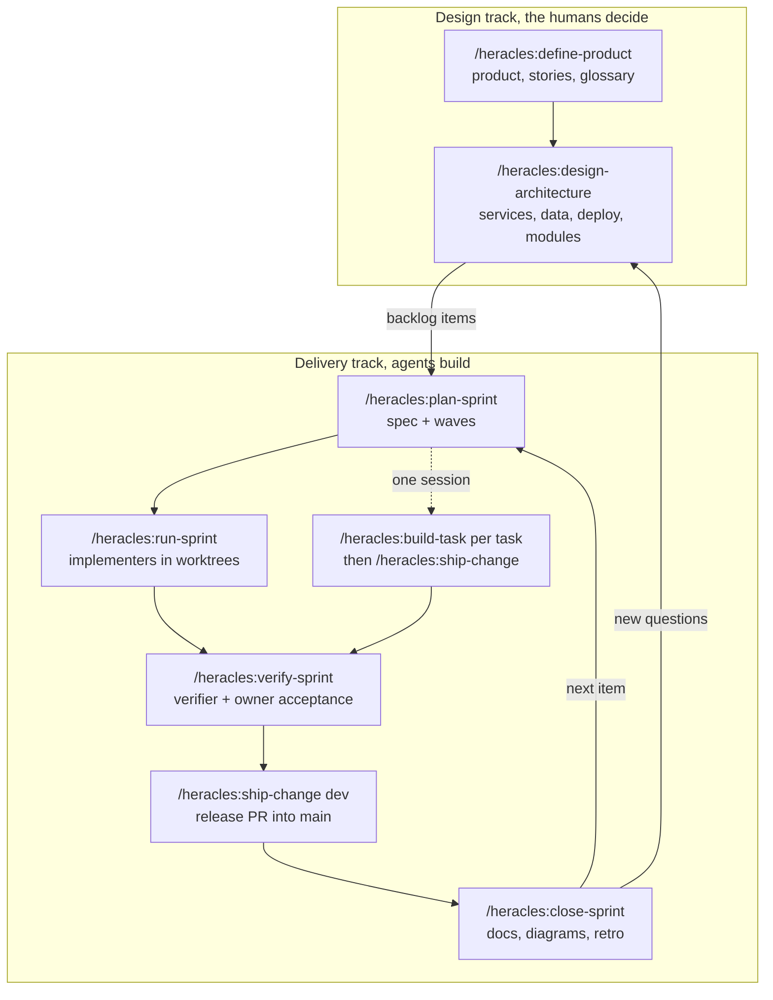

# Heracles

Heracles is a Claude Code plugin for spec-driven work with agents. It splits the work into two tracks. In the design track, Claude interviews the humans and writes the product definition, the user stories, the architecture and an ADR for every decision, and the humans make every call. In the delivery track, Claude plans sprints from those docs, builds the tasks with parallel implementer subagents in git worktrees, has separate subagents check the plan, review the diff and verify each acceptance criterion, and opens the pull requests.

Everything the workflow produces is Markdown in your repo: specs, plans, logs, evidence, ADRs and diagrams. A human merges every release into `main`, and two hooks keep subagents off the long-lived branches and keep the docs consistent.

## Install

In Claude Code:

```
/plugin marketplace add davidtobonm/heracles-skills
/plugin install heracles@heracles-skills
```

The plugin's skills run as `/heracles:<name>`.

## Quick start

1. In the root of a git repo, run `/heracles:init`. It adds `AGENTS.md`, `CLAUDE.md`, a `docs/` skeleton, `.claude/settings.json` with deny rules and some `.gitignore` lines, and never overwrites a file you have.
2. Commit those files on `main`, then create the integration branch: `git switch -c dev && git push -u origin dev`.
3. Fill the Commands section of `AGENTS.md` when the stack exists.
4. Run `/heracles:define-product` to start from the product, or `/heracles:plan-sprint <goal>` when the product and architecture are already clear.

Plugins cannot install permissions, rules or `AGENTS.md` into a project, which is why `init` copies them from the plugin's `templates/` folder.

## The workflow



A sprint is a folder `docs/sprints/S<NN>-<slug>/` with `spec.md` (stories and checkable acceptance criteria), `plan.md` (tasks in waves, each with scope, seams, a verify command, model and effort) and `log.md`. A plan checker reviews the plan before any code exists. Tasks in the same wave never share scope, so they run in parallel. A task marked one-way (a data migration, a public contract going live) waits for a human yes. The sprint ships before it closes, and closing it brings the living docs back in line with the code.

## User commands

| Command | What it does |
|---|---|
| `/heracles:init` | Sets up a repo for the workflow from the plugin's templates |
| `/heracles:define-product` | Interviews the owners; writes the product definition, glossary, story map and backlog |
| `/heracles:design-architecture` | Settles runtimes, services, data, stores and deploy; writes the LikeC4 model and ADRs |
| `/heracles:plan-sprint` | Turns stories into a spec and a plan in waves, checked by a separate subagent |
| `/heracles:run-sprint` | Builds a sprint with up to 3 parallel implementers, audits each task and merges its PR into `dev` |
| `/heracles:build-task` | Builds one task in this session, in its own worktree, test-first, with evidence |
| `/heracles:verify-sprint` | A fresh verifier checks every acceptance criterion, then an owner accepts the user-facing ones |
| `/heracles:ship-change` | Rebases, reviews, writes and opens the PR into `dev`, or the release PR from `dev` into `main` |
| `/heracles:close-sprint` | After the release merges, updates the living docs, runs a short retro and freezes the sprint |
| `/heracles:whats-next` | Says where the project stands and which command comes next |
| `/heracles:skill-guide` | Says which skills fit a goal, in order |
| `/heracles:review-change` | Independent reviewers, a 1-5 merge score and an optional fix loop |
| `/heracles:create-verification-skill` | Generates a project skill that drives the running app and captures evidence |
| `/heracles:maintain-verification-skill` | Keeps that verification skill and its feature map current |
| `/heracles:handoff` | Writes a handoff document for a fresh session |

Claude calls the helper skills on its own, and you can ask for them by name: `grilling`, `to-spec`, `to-tickets`, `tdd`, `domain-modeling`, `diagnosing-bugs`, `codebase-design`, `record-decision`, `draw-diagram`, `unslop` and `arena`. The plugin also ships four subagents: `implementer` (the only one that edits, and only in its worktree), `reviewer`, `verifier` and `plan-checker`. None of them has MCP tools.

## Branch model

- `main` is production. A human merges the release PR from `dev` into it.
- `dev` is the integration branch. Only the main session, the one talking with a human, commits on it (plans, closes, status) or merges PRs into it, and only when the human asked.
- Each task works on `task/S<NN>-<task>` in its own worktree under `.worktrees/`, and design work on `design/<topic>`. Both start from `dev` and merge into it by PR.
- A direct commit on `main` is an exception the human asks for, such as a hotfix. The main session makes it and merges `main` back into `dev`.

## Hooks

The plugin installs two hooks for every project where it is enabled.

- The branch guard runs before each Bash command. It blocks a subagent's `git commit` or `git merge` on `main`, `master` or `dev`, blocks every `gh pr merge` from a subagent, and blocks a `gh pr merge` from the main session unless the PR targets `dev`. It does nothing in a repo with no `dev` branch, so the plugin is safe to enable everywhere.
- The docs check runs when Claude stops. If the working tree changed, it runs `scripts/check_docs.py`, which checks relative links, the sprint and ADR indexes, ADR status lines, edits to closed sprints and line caps, and hands any failure back to Claude. It does nothing in a repo without `docs/sprints/`, when Claude is already continuing because of this hook, or when Claude's last message ends with a question.

The scripts also include `check-mermaid.mjs`, a Mermaid parse check that needs `npm i -D mermaid jsdom` in the project, and `before-after.sh`, which takes Playwright screenshots of the same states before and after a change.

## Credits

- [Matt Pocock's skills](https://github.com/mattpocock/skills) (MIT): `grilling`, `domain-modeling`, `tdd`, `diagnosing-bugs`, `handoff`, `codebase-design`, `to-spec` and `to-tickets` are copies with edits. His `code-review`, `implement` and `retro` shaped `review-change`, `build-task` and `close-sprint`.
- [pstack](https://github.com/cursor/plugins) by Lauren Tan, in `cursor/plugins` (MIT): `unslop`, `arena`, `create-verification-skill` and `maintain-verification-skill` are copies with edits. Its `interrogate` rubric, `architect`, `opening-a-pr` and `babysit` shaped `review-change`, `design-architecture` and `ship-change`.
- [GSD](https://github.com/open-gsd/gsd-core): ideas only, namely waves, the plan checker, the goal-backward verifier, requirement ids and `whats-next`.
- [Ras Mic's skills](https://github.com/michaelshimeles/skills): ideas only, namely isolating each task and proving it in `build-task`, and the ship step.

Each copied skill keeps its upstream `LICENSE` and a `SOURCE.md` with the upstream path, commit and the edits made.

## License

MIT. See [LICENSE](LICENSE).
