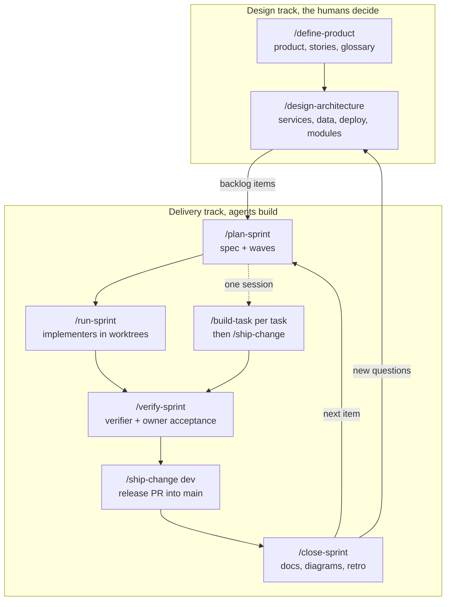

# Heracles

Heracles is a spec-driven workflow for coding agents, packaged as Agent Skills (folders with a `SKILL.md`). It splits the work into two tracks. In the design track, the agent interviews the humans and writes the product definition, the user stories, the architecture and a decision record (ADR) for every decision, and the humans make every call. In the delivery track, the agent plans sprints from those docs, builds the tasks with parallel implementer subagents in git worktrees or one task at a time, has separate subagents check the plan, review the diff and verify each acceptance criterion, and opens the pull requests.

Everything the workflow produces is Markdown in your repo: specs, plans, logs, evidence, ADRs and diagrams. A human merges every release into `main`. It runs in Claude Code, Codex, Cursor, OpenCode, Pi, Gemini CLI and any agent that reads Agent Skills.

## Install

Pick your agent. If you use more than one, install it in each.

| Agent | Install | Run a skill |
|---|---|---|
| Claude Code | `/plugin marketplace add davidtobonm/heracles-skills`, then `/plugin install heracles@heracles-skills` | `/heracles:name` |
| Codex | `codex plugin marketplace add davidtobonm/heracles-skills`, then `codex plugin add heracles@heracles-skills` | `$name` |
| Gemini CLI | `gemini extensions install https://github.com/davidtobonm/heracles-skills` | ask for the skill by name |
| Pi | `pi install git:github.com/davidtobonm/heracles-skills` | `/skill:name` |
| Cursor | `npx skills add davidtobonm/heracles-skills -a cursor`, or copy this repo to `~/.cursor/plugins/local/heracles` to load it as a Cursor plugin | `/name` |
| OpenCode | `npx skills add davidtobonm/heracles-skills -a opencode` | ask for the skill by name |
| GitHub Copilot, Windsurf, Amp, Cline, Goose, Kiro, Roo, Zed, Warp, Qwen Code and others | `npx skills add davidtobonm/heracles-skills -a <agent>` ([supported agents](https://github.com/vercel-labs/skills)) | as the agent does |

`npx skills add` without `-a` asks which agents to install for. Add `-g` to install for your user instead of the current project.

### Any other agent

An agent that reads skills from a folder needs only the `skills/` folder of this repo copied into that folder. An agent with no skill support can still follow the workflow: paste or reference a skill's `SKILL.md` when you want it, and let it read `AGENTS.md` (most agents do on their own).

## Quick start

1. In the root of a git repo, run the `init` skill. It asks which agents your team uses, then adds `AGENTS.md`, a `docs/` skeleton, the check scripts in `scripts/heracles/`, the subagent role files in `.heracles/roles/`, and per agent: `CLAUDE.md` and `.claude/settings.json` (Claude Code), `.cursor/hooks.json` (Cursor), `GEMINI.md` (Gemini CLI), `.opencode/agents/` (OpenCode). It never overwrites a file you have.
2. Commit those files on `main`, then create the integration branch: `git switch -c dev && git push -u origin dev`.
3. Fill the Commands section of `AGENTS.md` when the stack exists.
4. Run `define-product` to start from the product, or `plan-sprint <goal>` when the product and architecture are already clear.

`AGENTS.md` carries the rules and a "Run it in your agent" section, so every agent in the team, and every person, works the same way in the same repo.

## What works where

| | Skills | Subagents | Branch guard hook | Docs check on stop |
|---|---|---|---|---|
| Claude Code | yes | registered by the plugin | yes, after `init` | yes, after `init` |
| Codex | yes | role files as prompts, where your version has subagents | no, follow the rule in `AGENTS.md` | no, run `scripts/heracles/check_docs.py` |
| Cursor | yes | registered by the plugin, or role files as prompts | yes, after `init` | no |
| OpenCode | yes | after `init --opencode` | no | no |
| Pi | yes | none built in: one-session delivery | no | no |
| Gemini CLI | yes | role files as prompts | no | no |
| Others | yes | role files as prompts, if the agent has subagents | no | no |

Without subagents, the workflow still runs: `build-task` and `ship-change` per task replace `run-sprint`, and the agent does the reviewer and verifier passes itself, starting each from its role file.

## The workflow

`/name` below means "run the skill `name`" the way your agent does it.

A sprint is a folder `docs/sprints/S<NN>-<slug>/` with `spec.md` (stories and checkable acceptance criteria), `plan.md` (tasks in waves, each with scope, seams, a verify command, model and effort) and `log.md`. A plan checker reviews the plan before any code exists. Tasks in the same wave never share scope, so they run in parallel. A task marked one-way (a data migration, a public contract going live) waits for a human yes. The sprint ships before it closes, and closing it brings the living docs back in line with the code.

## Skills you run

| Skill | What it does |
|---|---|
| `init` | Sets up a repo for the workflow, for the agents your team uses |
| `define-product` | Interviews the owners; writes the product definition, glossary, story map and backlog |
| `design-architecture` | Settles runtimes, services, data, stores and deploy; writes the LikeC4 model and ADRs |
| `plan-sprint` | Turns stories into a spec and a plan in waves, checked by a separate subagent |
| `run-sprint` | Builds a sprint with up to 3 parallel implementers, audits each task and merges its PR into `dev` |
| `build-task` | Builds one task in this session, in its own worktree, test-first, with evidence |
| `verify-sprint` | A fresh verifier checks every acceptance criterion, then an owner accepts the user-facing ones |
| `ship-change` | Rebases, reviews, writes and opens the PR into `dev`, or the release PR from `dev` into `main` |
| `close-sprint` | After the release merges, updates the living docs, runs a short retro and freezes the sprint |
| `whats-next` | Says where the project stands and which skill comes next |
| `skill-guide` | Says which skills fit a goal, in order |
| `review-change` | Independent reviewers, a 1-5 merge score and an optional fix loop |
| `create-verification-skill` | Generates a project skill that drives the running app and captures evidence |
| `maintain-verification-skill` | Keeps that verification skill and its feature map current |
| `handoff` | Writes a handoff document for a fresh session |

The agent uses the helper skills on its own, and you can ask for them by name: `grilling`, `to-spec`, `to-tickets`, `tdd`, `domain-modeling`, `diagnosing-bugs`, `codebase-design`, `record-decision`, `draw-diagram`, `unslop` and `arena`. The four subagent roles are `implementer` (the only one that edits, and only in its worktree), `reviewer`, `verifier` and `plan-checker`. None of them has MCP tools.

## Branch model

- `main` is production. A human merges the release PR from `dev` into it.
- `dev` is the integration branch. Only the main session, the one talking with a human, commits on it (plans, closes, status) or merges PRs into it, and only when the human asked.
- Each task works on `task/S<NN>-<task>` in its own worktree under `.worktrees/`, and design work on `design/<topic>`. Both start from `dev` and merge into it by PR.
- A direct commit on `main` is an exception the human asks for, such as a hotfix. The main session makes it and merges `main` back into `dev`.

## Hooks and checks

`init` puts the scripts in `scripts/heracles/` in your repo, so every agent and every person runs the same checks.

- `branch-guard.sh` runs before each shell command in Claude Code and Cursor. In Claude Code it blocks a subagent's `git commit` or `git merge` on `main`, `master` or `dev`, blocks every `gh pr merge` from a subagent, and blocks a `gh pr merge` from the main session unless the PR targets `dev`. Cursor does not say whether a subagent runs a command, so there it blocks every commit and merge on `main` instead. It does nothing in a repo with no `dev` branch.
- `check-docs-hook.sh` runs `check_docs.py` when a Claude Code session stops with changes. `check_docs.py` checks relative links, the sprint and ADR indexes, ADR status lines, edits to closed sprints and line caps. Any agent can run it by hand: `python3 scripts/heracles/check_docs.py`.
- `check-mermaid.mjs` parse-checks Mermaid diagrams (needs `npm i -D mermaid jsdom`), and `before-after.sh` takes Playwright screenshots of the same states before and after a change.

## How the repo is laid out

- `skills/`: the skills, the one source every agent reads. `skills/init/` carries the templates, scripts and role files it copies into a project.
- `roles/`: the four subagent definitions, in Claude Code format. `scripts/sync.sh` copies them into `skills/init/files/roles/`.
- One manifest per agent, all pointing at the same `skills/`: `.claude-plugin/` (Claude Code plugin and marketplace), `.cursor-plugin/`, `.codex-plugin/` with `.agents/plugins/marketplace.json`, `gemini-extension.json` with `GEMINI.md`, and `package.json` (Pi package).
- `scripts/test.sh` checks the manifests, the skill frontmatter, the role copies, that skill text stays agent-neutral, `init` in a fresh repo, the branch guard in both hook formats and the diagrams.

To add a new agent with a plugin format, add its manifest next to the others, point it at `./skills/`, and add its install line to the table above.

## Credits

- [Matt Pocock's skills](https://github.com/mattpocock/skills) (MIT): `grilling`, `domain-modeling`, `tdd`, `diagnosing-bugs`, `handoff`, `codebase-design`, `to-spec` and `to-tickets` are copies with edits. His `code-review`, `implement` and `retro` shaped `review-change`, `build-task` and `close-sprint`.
- [pstack](https://github.com/cursor/plugins) by Lauren Tan, in `cursor/plugins` (MIT): `unslop`, `arena`, `create-verification-skill` and `maintain-verification-skill` are copies with edits. Its `interrogate` rubric, `architect`, `opening-a-pr` and `babysit` shaped `review-change`, `design-architecture` and `ship-change`.
- [GSD](https://github.com/open-gsd/gsd-core): ideas only, namely waves, the plan checker, the goal-backward verifier, requirement ids and `whats-next`.
- [Ras Mic's skills](https://github.com/michaelshimeles/skills): ideas only, namely isolating each task and proving it in `build-task`, and the ship step.
- [Superpowers](https://github.com/obra/superpowers) by Jesse Vincent (MIT): the layout of one `skills/` folder with a manifest per agent.

Each copied skill keeps its upstream `LICENSE` and a `SOURCE.md` with where it came from and the version.

## License

MIT. See [LICENSE](LICENSE).
