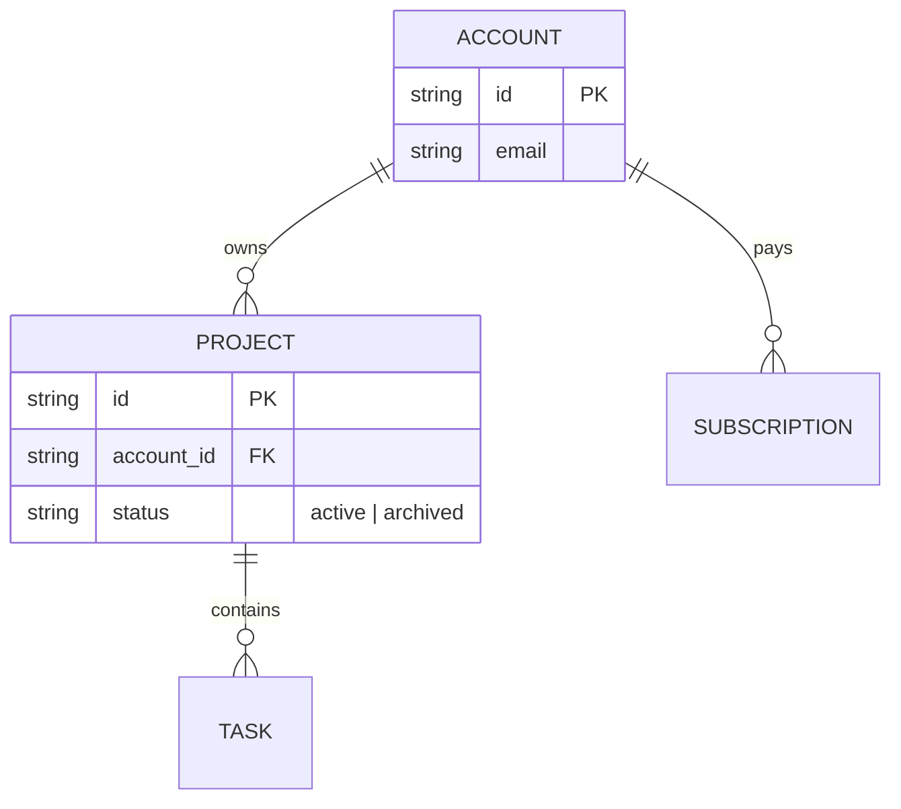
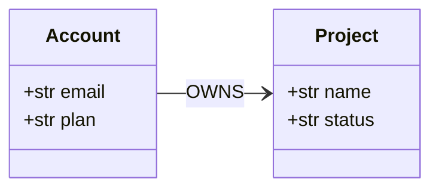

# Diagram tools

## Mermaid

GitHub renders fenced `mermaid` blocks in Markdown. Agents write flowcharts, sequence, class and ER diagrams reliably.

Parse check without a browser (needs `npm i -D mermaid jsdom` once in the project; the script loads them from the project's `node_modules`):

```bash
node "${CLAUDE_PLUGIN_ROOT}/scripts/check-mermaid.mjs" docs
```

The script finds every fenced `mermaid` block and every `.mmd` file under the folder and fails on the first syntax error in each.

Storage ER example:



Domain model example (generated, never hand-edited):



Limits. GitHub cannot load icon packs, so `architecture-beta` shows cloud icons only when rendered locally with `npx mmdc -i arch.mmd -o arch.svg --iconPacks @iconify-json/gcp @iconify-json/logos` (needs Chromium). Use LikeC4 for anything that needs icons.

## LikeC4

C4 model as code: one model, several views (context, containers, deployment), with built-in icon sets.

- `gcp:` has the official Google Cloud icons: `gcp:cloud-run`, `gcp:cloud-sql`, `gcp:firestore`, `gcp:cloud-storage`, `gcp:secret-manager`, `gcp:cloud-tasks`, `gcp:big-query`.
- `tech:` has tools and vendors: `tech:react`, `tech:typescript`, `tech:nodejs`, `tech:python`, `tech:postgresql`, `tech:docker`, `tech:github`, `tech:github-actions`, `tech:stripe`, `tech:anthropic`, `tech:claude`.
- `aws:` and `azure:` exist too.
- A vendor with no built-in icon uses its logo file: `icon ./icons/mailer.svg`, with the SVG committed in `docs/architecture/icons/`. Use the vendor's official logo from its press or brand page, and note the source in `docs/architecture/icons/README.md`.

Find an icon's exact name with `ls node_modules/@likec4/icons/gcp node_modules/@likec4/icons/tech | grep <word>`. `likec4 validate` fails on an icon name that does not exist.

Example: a web app on Cloud Run that takes payments through Stripe, signs in with GitHub and sends mail through a provider with no built-in icon.

```
specification {
  element actor
  element system
  element service
  element store
}
model {
  user = actor 'User'
  app = system 'Example app' {
    web = service 'Web app' { technology 'React'; icon tech:react }
    api = service 'API' { technology 'Cloud Run'; icon gcp:cloud-run }
    db = store 'Database' { technology 'Cloud SQL'; icon gcp:cloud-sql }
    files = store 'Files' { icon gcp:cloud-storage }
  }
  stripe = system 'Stripe' { icon tech:stripe }
  github = system 'GitHub' { icon tech:github }
  mailer = system 'Email provider' { icon ./icons/mailer.svg }
  user -> app.web 'uses'
  app.web -> app.api 'HTTPS'
  app.api -> app.db 'reads and writes'
  app.api -> app.files 'reads and writes'
  app.api -> stripe 'charges cards'
  app.web -> github 'signs in with OAuth'
  app.api -> mailer 'sends receipts'
}
views {
  view index { include *, app.* }
}
```

Commands (pin the version in `package.json`):

```bash
npx likec4 validate docs/architecture            # CI, no browser, fails on unknown elements and icons
npx likec4 export png -o docs/architecture/img docs/architecture   # needs Playwright
npx likec4 export drawio -o docs/pictures docs/architecture        # start of a hand-edited picture
```

GitHub does not render `.c4` files. Commit the exported PNGs next to the model and link them from `docs/architecture/overview.md`. Render them in CI or locally; do not diff PNG bytes.

## Generated diagrams

- Domain model. A script in the repo (for example `scripts/gen_model_doc.py`) imports the entity and relation types from the module that defines them and prints a Markdown file with a `classDiagram`. CI runs it and then `git diff --exit-code docs/architecture/`.
- SQL storage. `tbls doc` reads a database built from the schema file and writes Markdown with a Mermaid ER; `tbls diff` fails CI when the committed doc is behind.
- Document stores with no schema to read. Generate the ER from the typed models with the same script as the domain model.

## draw.io

Only for a polished picture nobody expects agents to maintain. Its Google Cloud shapes are `mxgraph.gcp3.*`. If a draw.io MCP server is connected, its `search_shapes` tool finds exact styles. Export with `drawio -x -f svg -e -o pic.drawio.svg pic.drawio`; `-e` embeds the editable XML. Keep the `.drawio` file for readable diffs.
