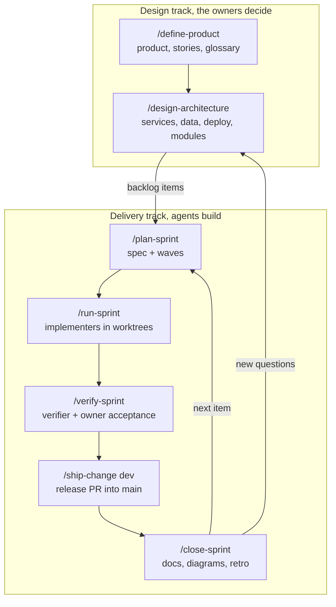

# How we work

Two tracks. The design track turns the owners' decisions into docs, diagrams and accepted ADRs. The delivery track builds what those docs say, in sprints with user stories, parallel implementers and independent checks. A human approves every design decision and merges every release.

## Design track

1. `/define-product` writes `docs/product/product.md`, the glossary and `docs/product/stories.md` (stories with ids such as `ACC-03`), and orders the backlog.
2. `/design-architecture` settles runtimes, services, data, stores and deploy with the owners. For one-way choices it runs `arena`: two or more competing candidates are scored by a separate judge against a rubric, and the owners pick. Every choice becomes an ADR with `Decided by`. It writes the LikeC4 model with cloud and vendor icons, and sketches each service's modules with `codebase-design`.

Each design skill works on a `design/<topic>` branch from `dev` and ends with `/ship-change`, so a decision reaches `dev` through a PR. Run a design skill again, on a new design branch, whenever a later sprint finds that a decision does not hold.

## Delivery track

1. `/plan-sprint` works on `dev`, takes stories, settles acceptance criteria with the owners, and writes tasks in waves with scope, seams, a verify command, and model and effort. The `plan-checker` subagent reviews it before code starts.
2. `/run-sprint` runs each wave's tasks in `implementer` subagents, each on its own `task/` branch in its own worktree started from `dev`. It audits each diff, opens a PR into `dev` for each passing task, and merges it, so a sprint can run unattended. It stops for the owners before any one-way task.
3. `/verify-sprint` has the `verifier` subagent check every acceptance criterion in a seeded demo or test environment, then walks an owner through each user-facing one. Failures become fix tasks.
4. `/ship-change dev` opens the release PR into `main`. It rebases, runs `review-change` (independent reviewers, a 1-5 score, up to 3 fix rounds), writes the PR from the stories and evidence, and watches CI. A human merges, and the deploy and smoke check follow.
5. `/close-sprint` runs after the release merges. It records the release and deploy result, brings the living docs and diagrams in line with the code, moves leftovers to the backlog, runs a three-line retro, and freezes the sprint folder, on `dev`.

One-session delivery. When a sprint is small or you want to steer each task, skip `/run-sprint`: run `/build-task <task>` yourself for each task in wave order, and `/ship-change` each task branch into `dev`. Then run `/verify-sprint` as usual. The plan, waves and acceptance criteria stay the same.

`main` is production and `dev` holds the next release. Only the main session commits on `dev` or merges PRs into it. A direct commit on `main` is an exception the human asks for (a hotfix), made only by the main session and merged back into `dev`. A hook enforces these rules.

## Guardrails that run on their own

| Guardrail | What it does |
|---|---|
| `scripts/heracles/branch-guard.sh` (Claude Code and Cursor hook) | Blocks subagent commits and merges on `main` and `dev`, and any PR merge except the main session's into `dev`. In Cursor it blocks every commit and merge on `main`. Other agents follow rule 11 in `AGENTS.md` without a hook |
| `scripts/heracles/check-docs-hook.sh` (Claude Code Stop hook) | Runs the docs check when files changed and hands failures back, unless the agent just asked the humans a question. In other agents, run `python3 scripts/heracles/check_docs.py` before you finish |
| `reviewer`, `verifier`, `plan-checker` (`.heracles/roles/`) | Subagents limited to reading and running checks, with no MCP tools, so no step grades its own work |
| `implementer` | Edits only in its worktree, with no MCP tools, and reads the path rules for its scope |
| `.claude/settings.json` deny rules (Claude Code) | Block reads of `.env` files other than `.env.example`, force pushes, pushes to `main` and bare `git push` |
| `worktree.baseRef: head` (Claude Code) | Implementer worktrees branch from `dev` and see the sprint spec |
| `.claude/rules/` (optional, Claude Code) | Area rules that load when Claude touches matching files |
